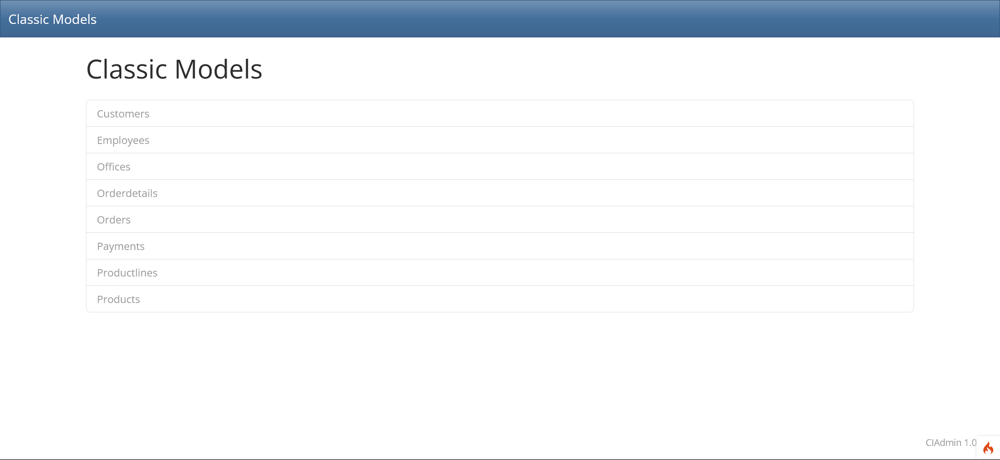
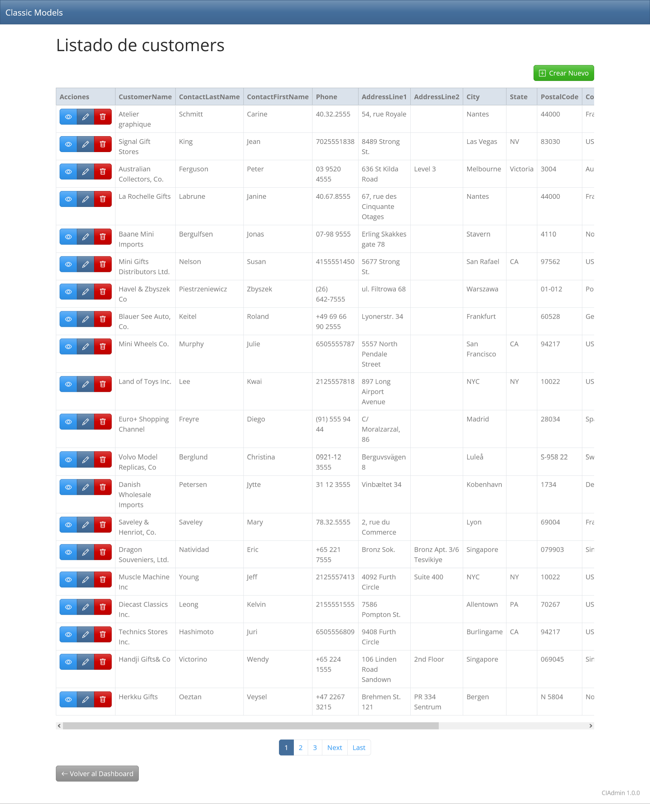
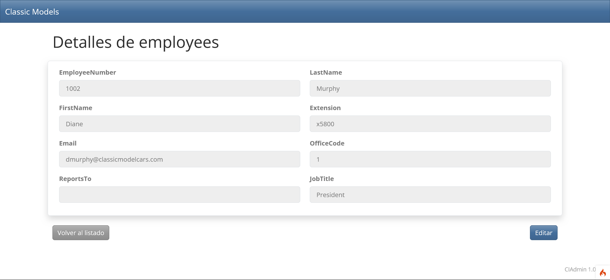
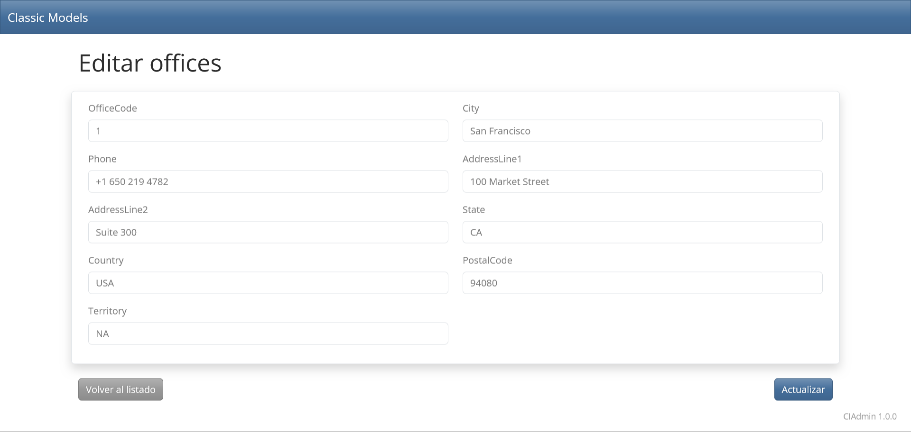
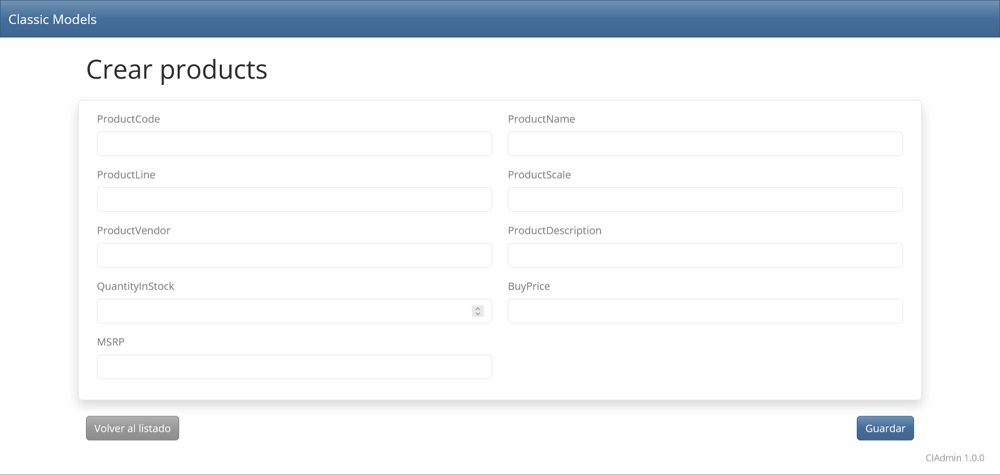
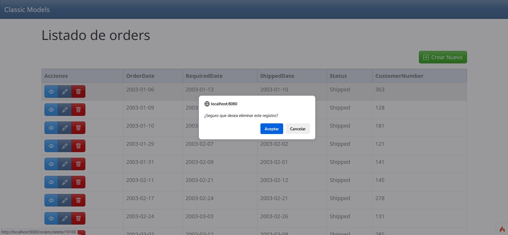

# CIAdmin v1.1.0


[Historial de cambios](CHANGELOG.md) · [Roadmap](ROADMAP.md)


## Crea tu panel de administración en segundos con CodeIgniter

---

## 📋 Descripción

**CIAdmin** es una herramienta para generar automáticamente una aplicación administrativa basada en una base de datos utilizando [CodeIgniter 4](https://codeigniter.com/).

Su objetivo es simplificar la creación de sistemas CRUD monolíticos con el menor esfuerzo posible, manteniendo el código generado limpio y fácil de extender.  
La idea es que funcione como punto de partida para cualquier aplicación que requiera administrar bases de datos.

---

## 🖼️ Capturas de pantalla

<table>
  <tr>
    <td><strong>Dashboard</strong></td>
    <td><strong>Listado</strong></td>
  </tr>
  <tr>
    <td></td>
    <td></td>
  </tr>
  <tr>
    <td><strong>Detalles</strong></td>
    <td><strong>Editar</strong></td>
  </tr>
  <tr>
    <td></td>
    <td></td>
  </tr>
  <tr>
    <td><strong>Crear</strong></td>
    <td><strong>Eliminar</strong></td>
  </tr>
  <tr>
    <td></td>
    <td></td>
  </tr>
</table>

---

## 🚀 Instalación y configuración

Este proyecto utiliza CodeIgniter 4, por lo que el proceso de instalación y configuración es el mismo que en cualquier aplicación basada en este framework.

📌 La diferencia es que debés **clonar este repositorio** o descargarlo, ya que contiene la versión ajustada de CodeIgniter y todo el sistema de generación automática.

> Para más detalles sobre la instalación y configuración general, consultá la [documentación oficial de CodeIgniter](https://www.codeigniter.com/user_guide/index.html).

**⚠️ Lo más importante:** asegurate de configurar correctamente la conexión a la base de datos, ya que CIAdmin utilizará estos datos para generar todos los componentes.

---

## ⚙️ Uso

Una vez que tu proyecto esté correctamente configurado, hayas instalado las dependencias de CodeIgniter corriendo composer install, ejecutá el siguiente comando en una terminal desde la raíz del proyecto:

```
php spark make:ciadmin
```

Esto generará automáticamente:

- Modelos
- Vistas básicas (index, create, edit)
- Controladores
- Rutas
- Un Dashboard de inicio con enlaces a cada módulo generado

---

### Opciones disponibles

- --appname / -a
  Define el nombre de la aplicación (usado en el título y navbar).
  Ejemplo: --appname "Mi Aplicación"

- --force / -f
  Fuerza la sobreescritura de archivos ya existentes. Ideal para actualizar.

- --only / -o
  Genera solo un tipo de componente. Valores posibles:
    model, controller, view, routes, dashboard
  Ejemplo: --only view
  También se aceptan los alias `models`, `controllers` y `views`.

- --table / -t
  Especifica una o más tablas (separadas por coma) para generar sus componentes.
  Ejemplo: --table users,posts
  
- --theme
  Permite utilizar un tema de [Bootswatch](https://bootswatch.com/) para la aplicación generada, si no se define se utilizará el tema por defecto de Bootstrap.

⚠️ **Importante**: Al utilizar opciones como --appname, recordá escribirlas separadas por espacios. No uses el símbolo = como en --appname="Mi App", ya que CodeIgniter no parsea esa sintaxis. Usá en cambio --appname "Mi App".

---

### Ejemplos

Regenerar todo el sistema, sobrescribiendo lo existente:

```
php spark make:ciadmin --force
```

Regenerar solo las vistas:

```
php spark make:ciadmin --only view --force
```

Generar solo el modelo y controlador para la tabla clients:

```
php spark make:ciadmin --only model --table clients
php spark make:ciadmin --only controller --table clients
```

Utiliza el tema Minty de Bootswatch:

```
php spark make:ciadmin --theme minty
```

Al regenerar rutas con `--table`, se conservan las rutas de los demás módulos y las rutas personalizadas. Las rutas CRUD generadas usan enrutamiento explícito.

Para migrar un módulo generado anteriormente, actualizá su vista de listado y su controlador junto con sus rutas. El botón de borrado envía un formulario protegido por CSRF a la ruta `DELETE`. Si personalizaste esos archivos, integrá los cambios antes de usar `--force`.

---

### 🧪 Probar la aplicación

Podés ejecutar la aplicación con:

1. Servidor embebido de CodeIgniter

  Ejecutá:

  ```
  php spark serve
  ```

  Luego accedé a http://localhost:8080/ en tu navegador.

2. Servidor web local (Apache, Nginx, IIS, etc.):

  - Configurá un virtual host que apunte a la carpeta /public.

---

## 📋 Requisitos

Se recomienda cumplir con los requisitos mínimos de CodeIgniter 4:

- PHP 8.2 o superior
- Composer
- MySQL o compatible
- Servidor Web (Apache, Nginx, etc.)

---

## 👥 Autores

- **Leonardo Panzardo**
  - [GitHub](https://github.com/leopanzardo)
  - [LinkedIn](https://www.linkedin.com/in/leopanzardo/)

---

## 📚 Créditos

Creado con ❤️ por Leonardo Panzardo.

